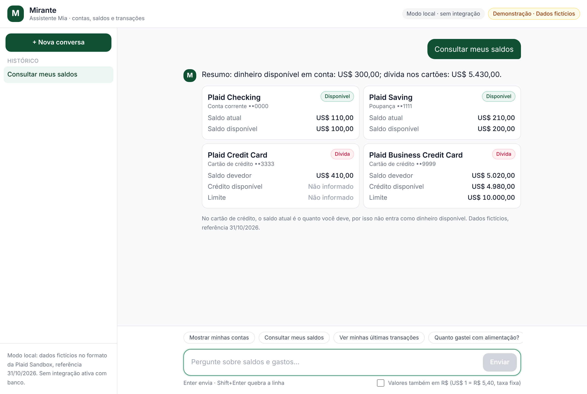
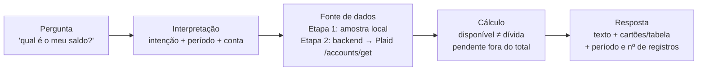
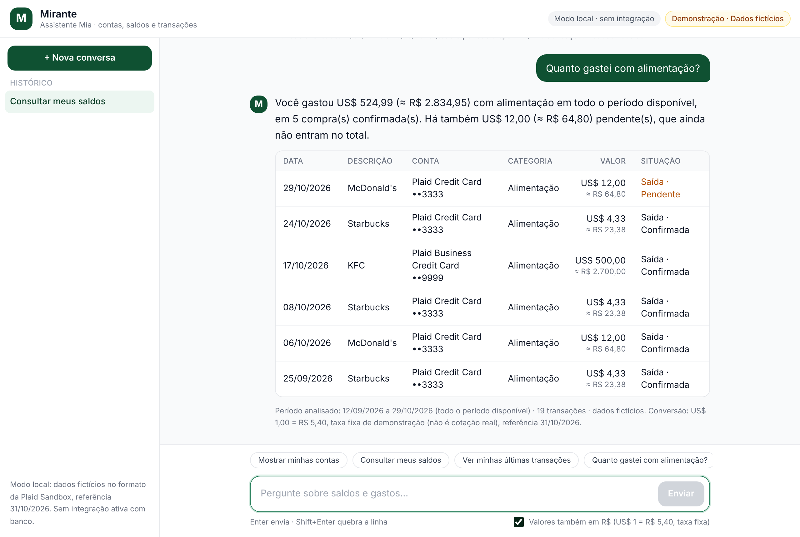
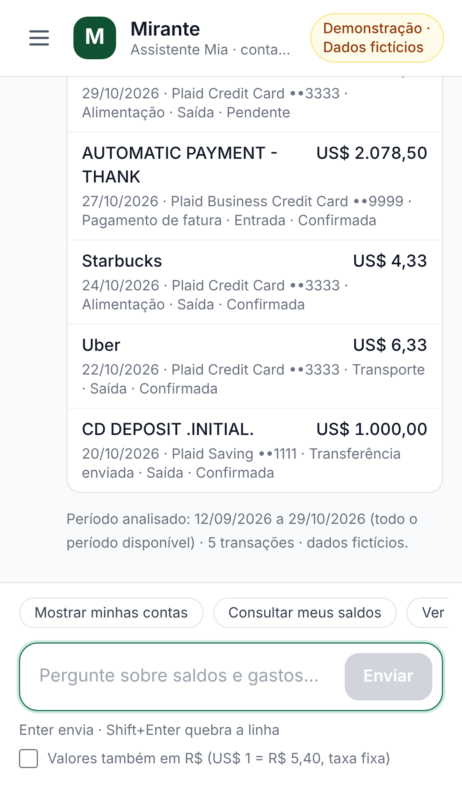
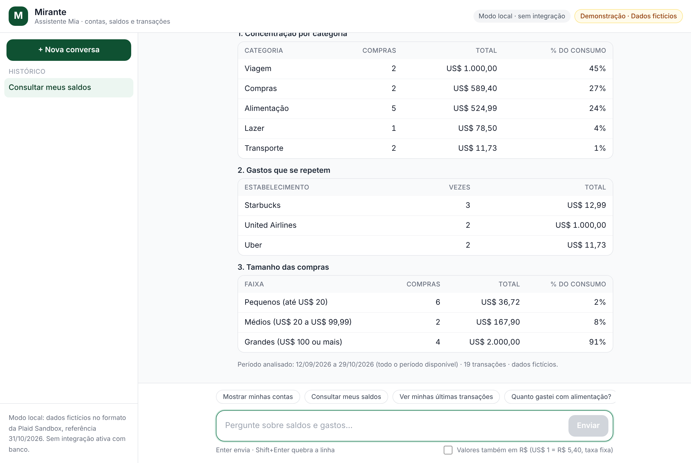

# Mirante · assistente financeiro com MCP

> **Demonstração educacional. Todos os dados são fictícios.** Nada aqui se conecta a um banco real, e a Plaid usada no laboratório não representa o Open Finance brasileiro, que em produção exige consentimento e segurança.

Chat em português em que a assistente **Mia** responde sobre contas, saldos e transações de um banco de teste. Projeto do desafio da DIO "Levar o banco para onde o cliente já está", refeito do zero a partir dos slides e do guia do Expert Bruno Lima.

**App publicado:** [preencher com o endereço do Lovable após publicar]
**Autor(a):** [seu nome]



---

## 1. Onde o cliente já está e o que o assistente responde

**Cenário: o app do banco.** O cliente abre o app do Mirante, um banco digital, e em vez de navegar por menus pergunta em linguagem natural.

| Pergunta (exemplos) | O que a Mia responde |
|---|---|
| "Mostrar minhas contas" | 4 contas, tipo, final e moeda |
| "Consultar meus saldos" / "saldo da poupança" | Saldo atual e disponível, separando **dinheiro disponível**, **dívida** e **limite** |
| "Ver minhas últimas transações" | As 5 mais recentes, com entrada/saída e pendente/confirmada |
| "extrato da conta corrente em outubro" | Transações filtradas por período e conta, com totais |
| "Quanto gastei com alimentação?" | Total confirmado da categoria, pendentes à parte |
| "Resumir minhas movimentações" | Entradas, consumo, transferências/faturas e pendentes |
| "Quais são meus padrões de gasto?" | Três tabelas: categorias, gastos que se repetem, tamanho das compras |
| "saldos em reais" | Os mesmos valores com o equivalente em R$ e a taxa declarada |
| "faça um pix" / "qual meu score?" | Recusa operações de escrita; diz que não tem o dado, sem inventar número |

### De onde vem cada dado

| Dado | Origem no laboratório (IA + MCP) | Origem no app (Etapa 1) |
|---|---|---|
| Conceitos (Item, endpoints) | MCP **Pluggy**, só documentação | Texto explicativo deste README |
| Contas e saldos | MCP **Plaid** → `POST /accounts/get` (Sandbox) | [`src/data/sandbox.ts`](src/data/sandbox.ts), amostra local no mesmo formato |
| Transações | MCP **Plaid** → `POST /transactions/get` (Sandbox) | [`src/data/sandbox.ts`](src/data/sandbox.ts), 19 transações fictícias |
| Taxa US$ → R$ | — | [`src/data/cambio.ts`](src/data/cambio.ts), taxa fixa declarada |

### O caminho de uma pergunta



O código segue esse desenho: [`src/lib/assistente.ts`](src/lib/assistente.ts) interpreta a pergunta e calcula; [`src/components/Blocos.tsx`](src/components/Blocos.tsx) desenha cartões, tabelas e barras; [`src/components/ChatApp.tsx`](src/components/ChatApp.tsx) é o chat, ligado à página inicial em [`src/routes/index.tsx`](src/routes/index.tsx). Na Etapa 2 só a fonte muda.

**Por que o saldo do cartão aparece como dívida?** Na Plaid, em contas de crédito, `balances.current` é o quanto você deve. Somar isso ao saldo da conta corrente daria um "dinheiro disponível" falso, então a Mia mostra os dois grupos separados. Pela mesma lógica, `amount` positivo é **saída** e negativo é **entrada**, e pagamento de fatura ou transferência entre contas não conta como consumo.

---

## 2. Como configurar os servidores MCP

Resumo abaixo. Passo a passo completo, com Windows e erros comuns, em [`docs/configuracao-mcp.md`](docs/configuracao-mcp.md). Modelo do arquivo em [`docs/mcp/codex-config.example.toml`](docs/mcp/codex-config.example.toml).

**Pluggy (documentação, sem chave)**
- Tipo **Streamable HTTP**, nome `pluggy`, URL `https://mcp.pluggy.ai/mcp`, sem autenticação.
- Conferir com `/mcp` e pedir: "explique o que é um Item, com as fontes".

**Plaid (dados fictícios do Sandbox)**
1. Copiar Client ID e Sandbox secret em dashboard.plaid.com → Developers → Keys.
2. Instalar o `uv` e achar o caminho absoluto do `uvx`.
3. Adicionar servidor **STDIO** `plaid`: comando = caminho do `uvx`, argumento `mcp-server-plaid`, variáveis `PLAID_CLIENT_ID` e `PLAID_SECRET`.
4. Reiniciar o Codex, abrir conversa nova, conferir `/mcp`.

```toml
[mcp_servers.pluggy]
url = "https://mcp.pluggy.ai/mcp"

[mcp_servers.plaid]
command = "/CAMINHO/ABSOLUTO/PARA/uvx"
args = ["mcp-server-plaid"]
startup_timeout_sec = 60

[mcp_servers.plaid.env]
PLAID_CLIENT_ID = "COLE_SEU_CLIENT_ID"
PLAID_SECRET = "COLE_SEU_SANDBOX_SECRET"
```

Os prompts usados para criar o Item de teste, ler contas e transações e montar as **três tabelas de padrões de gasto** estão em [`docs/prompts-ia.md`](docs/prompts-ia.md).

---

## 3. Especificação enviada ao Lovable e ajustes

A especificação completa, no formato OpenSpec, está em [`docs/prompt-lovable.md`](docs/prompt-lovable.md). Ela segue as páginas 25 a 28 do guia, com marca **Mirante**, assistente **Mia** e o requisito extra de valores em reais. Foi mandada primeiro no modo chat, para tirar dúvidas, e depois no modo de construção.

O que ajustei depois de testar a primeira versão:

- No celular, cada linha de tabela virou um cartão, para o valor nunca ficar escondido na rolagem lateral.
- Valor em reais numa segunda linha, menor, para a tabela caber.
- "Tipo" e "Status" juntos numa coluna "Situação" (ex.: "Saída · Pendente").
- Com a conversão ligada, pergunta desconhecida continua respondendo "não encontrei", em vez de cair na explicação de câmbio.

---

## 4. Melhoria escolhida: valores também em reais

Marque **"Valores também em R$"** abaixo do campo de mensagem, ou peça "saldos em reais". Cada valor aparece como `US$ 110,00 (≈ R$ 594,00)` e a resposta declara a conversão:

> Conversão: US$ 1,00 = R$ 5,40, taxa fixa de demonstração (não é cotação real), referência 31/10/2026.

A taxa fica num único lugar, [`src/data/cambio.ts`](src/data/cambio.ts). Os valores originais em dólar nunca são substituídos.



**Extra:** a configuração dos dois servidores também virou uma skill de agente, em [`skills/configurar-mcp-financeiro/SKILL.md`](skills/configurar-mcp-financeiro/SKILL.md).

---

## Evidências

Prints e checklist do que adicionar em [`docs/evidencias/`](docs/evidencias/README.md).

| Celular | Padrões de gasto |
|---|---|
|  |  |

---

## Como o código está organizado

O projeto nasceu no Lovable (modelo TanStack Start, React + TypeScript + Tailwind) e recebeu os arquivos do assistente pelo GitHub:

| Arquivo | Papel |
|---|---|
| [`src/routes/index.tsx`](src/routes/index.tsx) | Página inicial: mostra o chat |
| [`src/components/ChatApp.tsx`](src/components/ChatApp.tsx) | Tela do chat, histórico, sugestões, caixa de reais |
| [`src/components/Blocos.tsx`](src/components/Blocos.tsx) | Desenha texto, cartões, tabelas e barras |
| [`src/lib/assistente.ts`](src/lib/assistente.ts) | Interpreta a pergunta e calcula a resposta |
| [`src/lib/assistente.test.ts`](src/lib/assistente.test.ts) | 15 testes das regras (dívida, pendentes, reais, recusa) |
| [`src/data/sandbox.ts`](src/data/sandbox.ts) | Dados fictícios no formato Plaid |
| [`src/data/cambio.ts`](src/data/cambio.ts) | Taxa de conversão declarada |

Para rodar no computador: `npm install`, `npm run dev` e `npm test`. A Etapa 1 não usa nenhuma chave nem variável de ambiente.

## Como publiquei

1. No Lovable, criei o projeto e mandei a especificação de [`docs/prompt-lovable.md`](docs/prompt-lovable.md) no modo chat.
2. Liguei o projeto ao GitHub (**Configurações → Git**). O Lovable criou este repositório.
3. Subi os arquivos do assistente pelo GitHub. O Lovable sincroniza nos dois sentidos.
4. Publiquei pelo botão **Publish** do Lovable.

## Próximo passo: Etapa 2

Backend com `POST /accounts/get` e `POST /transactions/get` (todas as páginas), só em `https://sandbox.plaid.com`, com `PLAID_CLIENT_ID`, `PLAID_SECRET` e `PLAID_ACCESS_TOKEN` apenas no servidor (veja [`.env.example`](.env.example)). Tratar `PRODUCT_NOT_READY` com tentativas limitadas. Webhooks (`SYNC_UPDATES_AVAILABLE`) e avisos por push/WhatsApp ficam para depois.

## Segurança

- Nenhuma chave, token ou senha neste repositório. `.env` e `config.toml` estão no `.gitignore`.
- Um secret da Plaid apareceu num print durante os testes; ele foi trocado (Rotate) no painel da Plaid e o print não foi usado.
- O histórico de conversas fica só no navegador de quem usa, e não guarda credenciais.
- O assistente não faz pagamentos, Pix, transferências nem contratação de crédito.
